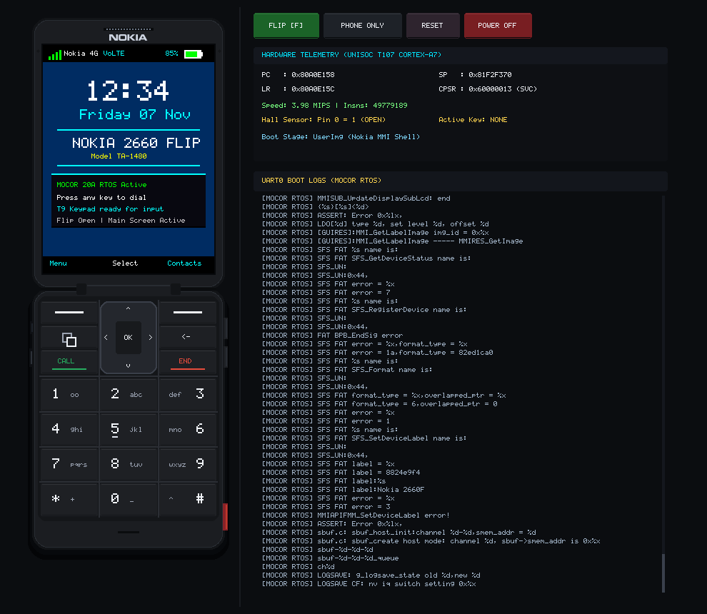

# Nokia 2660 Flip Emulator (N2660Emu)

[](LICENSE)
[](#)
[](#target-hardware-specifications)
[-red.svg)](#target-hardware-specifications)
[-brightgreen.svg)](docs/RUST_ENGINE.md)
[](https://github.com/lovelytingy/OpenFeatureOS)

<a href="https://buymeacoffee.com/lovelytingy"></a>

An open-source hardware emulation and reverse-engineering environment for the **Nokia 2660 Flip** (Model **TA-1480**, India variant), powered by the **Unisoc T107 / UMS9117** platform.

<p align="center">
  
</p>

The goal of this project is to understand and emulate the phone's hardware environment sufficiently to execute and debug firmware components, investigate the original **MOCOR** RTOS, and serve as the official development and testing platform for [**OpenFeatureOS**](https://github.com/lovelytingy/OpenFeatureOS).

> [!WARNING]
> **Project Status — Active Development**:
> This project is currently in **active development**. As hardware reverse-engineering and emulation are ongoing, **some features, peripherals, and components might not work as intended or may be incomplete**. Bugs, missing register behaviors, and breaking changes are expected as development continues. We welcome bug reports, hardware findings, and pull requests!

> [!IMPORTANT]
> **Legal Notice & Non-Affiliation**: This project is an independent open-source research effort and is **not affiliated with, sponsored by, or endorsed by Nokia Corporation, HMD Global Oy, or Unisoc Technologies Co., Ltd.** All trademarks belong to their respective owners. **No proprietary firmware binaries are distributed in this repository.** See [DISCLAIMER.md](DISCLAIMER.md) and [CONTRIBUTING.md](CONTRIBUTING.md).

---

## Target Hardware Specifications

| Component | Specification |
| :--- | :--- |
| **Device & Model** | Nokia 2660 Flip (Model TA-1480, India Variant) |
| **SoC / Platform** | Unisoc T107 / UMS9117-L (Single-core ARM Cortex-A7 @ 1.0 GHz) |
| **Memory** | 64 KB On-Chip SRAM (`0x00000000`), 48 MB SIP LPDDR2 DRAM (`0x80000000`) |
| **Storage** | 128 MB SPI NAND Flash (Winbond W25N01GV) with direct XIP (`0x60000000`) |
| **Displays** | Primary 2.8" QVGA (240×320) GC9307 TFT LCD + Sub 1.77" QQVGA (120×160) ST7735 |
| **Input / Audio** | SPRD 3×4 Keypad Matrix, GPIO Pin 0 Hall Clamshell Flip Sensor, Audio DAC & Tone Buzzer |
| **Target OS** | MOCOR RTOS / [OpenFeatureOS](https://github.com/lovelytingy/OpenFeatureOS) |

---

## Features

- **High-Performance Rust Core**: Pure Rust execution engine (`crates/n2660-core`) delivering **16+ MIPS** via zero-cost FFI MMIO hooks, bit-exact peripheral simulation, and ARM IRQ exception vector dispatch.
- **Authentic Desktop Host GUI**: Native Cocoa/minifb window (`make gui`) replicating the physical Nokia 2660 Flip hardware:
  - Slender Matte Black composite chassis with pill-rounded corners and dual-bevel specular shading.
  - Iconic silver embossed Nokia corporate wordmark positioned after the earpiece.
  - 60 FPS physics-accurate 3D clamshell flip animation with cosine ease-in-out rotation.
  - Touch/mouse clamshell drag gestures: drag upper display down to close, drag front cover up to open.
  - Complete 3-column continuous keypad, chrome squircle D-Pad, Key 5 tactile bump, and side keys (Volume Up, Volume Down, and lower-flank SOS Emergency button).
  - Dual view modes: Phone-Only view (with an elegant floating bottom pill dock) and Split Dev Deck (telemetry deck + interactive UART0 serial console with native host OS right-click copying).
  - Genuine vendor boot splash rendering directly from extracted `MMIRes` via Spreadtrum RLE16 decompression.
- **ANSI Truecolor Terminal TUI**: Real-time terminal interface (`make interactive`) with half-block downsampled dual displays, live T9 keypad matrix, and hardware telemetry.
- **Reverse-Engineering Toolchain**: Native Rust tools for Spreadtrum BSL protocol framing, BOOT0 image packaging, `.PAC` firmware container unpacking/packing, ATAGS staging, and annotated ARM disassembly.
- **Zero Proprietary Blobs**: Standalone clean-room ARMv7-A BootROM and baremetal verification firmware.

---

## Quick Start

### Supported Operating Systems
* **Linux**: Fully supported (Ubuntu, Debian, Fedora, Arch Linux, and derivative distros with X11/Wayland).
* **macOS**: Fully supported (Apple Silicon M1/M2/M3/M4 & Intel x86_64).

> [!IMPORTANT]
> **Windows Compatibility Notice**:
> This project is designed, built, and maintained exclusively for **Linux** and **macOS**. We do **not** provide any support, troubleshooting, bug fixes, or compatibility assurances for Windows. Issues, bug reports, and pull requests relating to native Windows compilation, pathing, or execution will be **respectfully declined and closed**.
> 
> If you are on Windows and wish to run N2660Emu, you are welcome to research and set it up on your own. The recommended and easiest path is to use **WSL2 (Windows Subsystem for Linux)** with an Ubuntu environment and WSLg / X11 display forwarding.

---

### Prerequisites & Installation

#### 1. Linux Setup

##### Debian / Ubuntu / Linux Mint / Pop!_OS
```bash
# Install core build dependencies, CMake (for Unicorn), and X11 graphics libraries (for GUI)
sudo apt update && sudo apt install -y \
    build-essential \
    cmake \
    pkg-config \
    libx11-dev \
    libxcursor-dev \
    libxrandr-dev \
    libxi-dev \
    libxinerama-dev \
    libxkbcommon-dev \
    python3 \
    xclip

# Optional: ARM cross-compiler (only required if recompiling baremetal test payloads)
sudo apt install -y gcc-arm-none-eabi binutils-arm-none-eabi

# Install Rust toolchain (if not already installed)
curl --proto '=https' --tlsv1.2 -sSf https://sh.rustup.rs | sh
source "$HOME/.cargo/env"
```

##### Fedora / RHEL
```bash
sudo dnf install -y \
    gcc gcc-c++ make cmake pkgconf \
    libX11-devel libXcursor-devel libXrandr-devel libXi-devel libXinerama-devel libxkbcommon-devel \
    python3 xclip arm-none-eabi-gcc-cs arm-none-eabi-newlib

# Install Rust toolchain
curl --proto '=https' --tlsv1.2 -sSf https://sh.rustup.rs | sh
source "$HOME/.cargo/env"
```

##### Arch Linux / Manjaro
```bash
sudo pacman -S --needed \
    base-devel cmake pkg-config \
    libx11 libxcursor libxrandr libxi libxinerama libxkbcommon \
    python xclip arm-none-eabi-gcc arm-none-eabi-newlib rustup

rustup default stable
```

#### 2. macOS Setup (Apple Silicon & Intel)
```bash
# Install dependencies via Homebrew
brew install rust cmake arm-none-eabi-gcc
```

---

### Essential Commands

```bash
# Build firmware, clean-room BootROM, and native Rust engine
make

# Run baremetal hardware verification payload
make run

# Launch native Desktop GUI with Nokia 2660 physical skin & live boot progression
cargo run -p n2660-cli -- --gui
# Or shorthand launcher:
./bin/n2660emu --gui

# Launch interactive real-time terminal TUI
make interactive

# Run full integration test suite (100% Rust workspace tests)
make test
```

---

## CLI & Tooling Reference

The main emulator CLI [`bin/n2660emu`](bin/n2660emu) provides full control over hardware simulation:

```bash
# Launch interactive Desktop GUI (auto-detects PAC, boots all stages in order, displays LCD)
cargo run -p n2660-cli -- --gui

# Cold boot official Nokia PAC firmware through all stages in order (BOOT0 -> BOOT1 -> Kernel -> MMI)
./bin/n2660emu --stage boot0 --timeout 10

# Boot directly into MOCOR OS Kernel (0x80a06000)
./bin/n2660emu --stage kernel --timeout 10

# Boot directly into Userland Application Framework (MS_MMI_Main at 0x88479F6F)
./bin/n2660emu --stage user --timeout 10

# Test bare-metal LCD payload with live 240x320 framebuffer updates
./bin/n2660emu path/to/baremetal_lcd.bin --timeout 5

# Test bare-metal ASM payload with mailbox diagnostics (0x80700100)
./bin/n2660emu path/to/baremetal_asm.bin --timeout 5

# Launch Desktop GUI with built-in interactive Nokia 2660 Flip OS demo
./bin/n2660emu --gui

# Direct execution of official downloaded vendor .PAC firmware in Desktop GUI
./bin/n2660emu path/to/Nokia_2660_Flip_TA-1480.pac --gui

# Launch directly with clamshell closed (outer sub-display active)
./bin/n2660emu --gui --flip closed

# Boot ARM Linux / MOCOR OS kernel with ATAGS handoff
./bin/n2660emu zImage --entry 0x80008000 --atags --cmdline "console=ttyS0,115200 root=/dev/mtdblock3 ro mem=48M"
```

### Standalone Utilities ([`tools/`](tools/))

| Utility | Description | Example Usage |
| :--- | :--- | :--- |
| [`tools/pac_extractor`](tools/pac_extractor) | Unpack, inspect, and build Spreadtrum `.PAC` packages | `./tools/pac_extractor extract fw.pac -o extracted_fw/` |
| [`tools/mksprd_img`](tools/mksprd_img) | Create & verify SPRD BOOT0 headers | `./tools/mksprd_img create -i fw.bin -o boot0.bin` |
| [`tools/atags`](tools/atags) | Build & inspect binary ARM Boot Tags lists | `./tools/atags build -o atags.bin --cmdline "..."` |
| [`tools/disasm`](tools/disasm) | Disassemble ARMv7-A/Thumb with T107 symbols | `./tools/disasm test_firmware.bin --base 0x80000000` |
| [`tools/bsl_engine`](tools/bsl_engine) | Spreadtrum BSL HDLC framing & CRC16 calculator | `./tools/bsl_engine --crc16 "123456789"` |

---

## Documentation Index

Comprehensive technical documentation is maintained in the [`docs/`](docs/) directory:

| Document | Description |
| :--- | :--- |
| [**Real Firmware Execution Guide**](docs/REAL_FIRMWARE_GUIDE.md) | How to download, inspect, stage, and run official Nokia 2660 `.PAC` firmware |
| [**Architecture Guide**](docs/ARCHITECTURE.md) | High-level emulator design, SoC architecture, and data pipelines |
| [**Rust Engine & Benchmarks**](docs/RUST_ENGINE.md) | Native Rust engine details, zero-cost FFI, and performance benchmarks |
| [**Desktop Host GUI**](docs/DESKTOP_GUI.md) | Nokia 2660 Flip physical skin, hit-testing, dual LCDs, and controls |
| [**Interactive Terminal TUI**](docs/INTERACTIVE_UI.md) | 24-bit ANSI Truecolor dual-display rendering and T9 keypad matrix |
| [**Memory Map & Registers**](docs/MEMORY_MAP.md) | Verified memory addresses, MMIO peripherals, and register definitions |
| [**Boot Flow Specification**](docs/BOOT_FLOW.md) | Reset vector, BootROM flow, BOOT0 headers, and staging mechanics |
| [**BSL Protocol Specification**](docs/BSL_PROTOCOL.md) | Spreadtrum BSL HDLC framing (`0x7E`), command opcodes, and CRC-16 |
| [**Firmware Packaging (.PAC)**](docs/FIRMWARE_PACKAGING.md) | Unisoc `.PAC` container layout, partition records, and pack/unpack flow |
| [**ATAGS & Kernel Handoff**](docs/ATAGS_AND_KERNEL_BOOT.md) | ARM Boot Tags synthesis, DRAM placement, and register state (`r0=0, r1=0x9117, r2=0x80000100`) |
| [**Hardware Peripherals**](docs/PERIPHERALS.md) | Specifications for SPRD UART, Timers, GPIO, INTC, SFC, Audio, GC9307, ST7735 |

---

## Project Structure

```
Nokia-2660-Emulator/
├── bin/n2660emu                 # Unified CLI launcher
├── Cargo.toml                   # Root Cargo workspace manifest
├── crates/
│   ├── n2660-core/              # Hardware simulation library (T107 VM, MMIO, BSL, PAC, ATAGS)
│   ├── n2660-cli/               # Native CLI binary, Desktop GUI (minifb) & Terminal TUI (crossterm)
│   └── n2660-tools/             # Native tooling & firmware packaging crate
├── docs/                        # Deep-dive architecture & hardware specifications
├── hw/                          # QEMU C peripheral models (UART, Timer, GPIO, INTC, SFC, Displays)
├── roms/                        # Standalone clean-room ARMv7-A BootROM assembly & binary
├── tests/baremetal/             # Baremetal verification firmware & interactive Nokia demo
├── tools/                       # Standalone tool binaries (pac_extractor, mksprd_img, atags, disasm)
└── Makefile                     # Root build, test, and run orchestrator
```

---

## Roadmap

- [x] **Phase 1: CPU & Memory Emulation** (ARM Cortex-A7, SRAM, DRAM, SPRD UART)
- [x] **Phase 2: T107 Core SoC** (Timers, GPIO, MMIO access logging, down-counter verification)
- [x] **Phase 3: Nokia Peripherals** (GC9307 QVGA, ST7735 outer LCD, Keypad matrix, Hall flip sensor, SFC 128 MB SPI NAND, Audio DAC & Buzzer)
- [x] **Phase 4: BootROM, BSL, PAC Tools, ATAGS & INTC** (Reset vector, BSL framing & CRC16, PAC tools, ARM ATAGS handoff, 32-line INTC & IRQ vectors)
- [x] **Phase 5: High-Performance Rust Emulation Core & Native Host GUI** (100% Rust workspace, zero-cost FFI, 16+ MIPS, native Desktop GUI with phone skin)
- [x] **Phase 6: MOCOR OS Bringup & Vendor Firmware Execution** (BOOT0 -> BOOT1 -> MOCOR OS Kernel execution, FTL & LK handoff, LCDC QVGA refresh, bare-metal payload verification)
- [ ] **Phase 7: OpenFeatureOS Development** (Custom open-source operating system bringup and hardware driver verification — see [OpenFeatureOS](https://github.com/lovelytingy/OpenFeatureOS))

---

## Ecosystem & Companion Projects

* 🌟 [**OpenFeatureOS**](https://github.com/lovelytingy/OpenFeatureOS): A modern open-source operating system purpose-built for 4G feature phones. N2660Emu provides the primary virtualized testing, emulation, and driver bringup environment for OpenFeatureOS!
* 🔬 [**Nokia-2660-RE**](https://github.com/lovelytingy/Nokia-2660-RE): Research, hardware partition manifests, BSL dumps, Ghidra database mappings, and bare-metal DRAM payloads for the Nokia 2660 Flip (Model TA-1480).

---

## ❤️ Support My Work

I am an independent developer building this open-source emulator. If you find this project valuable, voluntary contributions help support hardware research, testing equipment, and ongoing development:

<a href="https://buymeacoffee.com/lovelytingy"></a>

---

## License

This project is licensed under the [MIT License](LICENSE).
