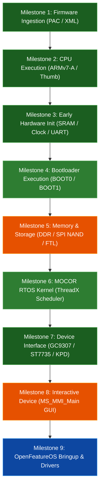

# Nokia 2660 Flip Emulator (N2660Emu) — Roadmap & Boot Milestones

This document defines the technical roadmap and honest boot milestones for N2660Emu. Each milestone represents a verified phase of hardware emulation and firmware execution on the **Unisoc T107 / UMS9117** platform (ARM Cortex-A7).

> [!IMPORTANT]
> **Strict Engineering Rule**: A milestone is marked completed **only** when original vendor firmware code or verified bare-metal payload code genuinely executes the initialization steps without mocked function redirection or hardcoded graphical replacement.

---

## Boot Milestones

---

### Milestone 1 — Firmware Ingestion
- [x] Load and parse official Unisoc `.pac` firmware packages (e.g., `v23_update_Nokia_2660.pac`).
- [x] Parse header metadata: Product Name (`UMS9117`), Version (`MOCOR_20A_MP`), Flash Type (`1 = NAND`).
- [x] Identify and extract all 29 partition entries: `FDL1`, `FDL2`, `BOOT0`, `BOOT1`, `KernelImg`, `UserImg`, `MMIRes`, `GSMDSPCODE`, `LTEDSPCODE`, `NV`.
- [x] Parse embedded partition geometry manifest (`UMS9117.xml`).
- [x] Validate image sizes, offsets, and partition boundaries (distinguish physical payloads from virtual partition placeholders).

### Milestone 2 — CPU Execution
- [x] Initialize ARM Cortex-A7 (ARMv7-A / AArch32) execution core using Unicorn Engine 2.1.5.
- [x] Support seamless ARM $\leftrightarrow$ Thumb / Thumb-2 mode switching via CPSR `T` bit (bit 5).
- [x] Configure CP15 Coprocessor Access Control (`CPACR` CP10/CP11 full access) and `FPEXC` (bit 30 = 1) for VFPv4/NEON instructions.
- [x] Verify CPU register read/write integrity across `R0`..`R15`, `CPSR`, and `SPSR`.
- [x] Support execution speeds exceeding 16+ MIPS on Apple Silicon (ARM64 macOS) and Linux.

### Milestone 3 — Early Hardware Initialization
- [x] Clean-room BootROM reset vector at `0x00000000` with SPRD header validation.
- [x] Internal SRAM (64 KB at `0x00000000`) access with cold-boot stack pointer at `0x0000FF00`.
- [x] Clock and reset controller (`0x402E0000` / `0x402E1000`) responding to AHB/APB power-on and soft-reset sequences.
- [x] UART0 console controller (`0x50000000` / `0x70000000`) outputting vendor boot diagnostics.
- [x] Unmapped MMIO access logging: track address, size, value, PC, and access type without crashing Apple Silicon JIT.

### Milestone 4 — Bootloader Execution
- [x] Execute authentic `BOOT0` (SPL) machine code from `boot0.bin`.
- [x] Observe genuine BOOT0 UART outputs:
  - `DDR init start` $\rightarrow$ `sdram_clk_init begin` $\rightarrow$ `dmc_dll_init end` $\rightarrow$ `lpddr_powerup_init end` $\rightarrow$ `dmc_init_post_setting end` $\rightarrow$ `qos init end` $\rightarrow$ `DDR init OK`.
  - `boot0 started!: 44bd`, `boot0 UART/JTAG mode = 2`, `boot0 nand flash ID 0xbaef!`, `load boot1 suc`.
- [x] Execute authentic `BOOT1` (LK) machine code from `boot1.bin` at `0x80100200`:
  - `boot1 started!: 1f734`, `rst_monitor_register is 0`, `boot1 nandflash init!`.
  - `boot1 boot1_PartitionSwap enter` $\rightarrow$ `order by ofst` $\rightarrow$ `replace SCI_FTL_REMAIN_AREA by number` $\rightarrow$ `end`.
- [ ] Eliminate simulated FTL / `load_kernel()` bypass hooks: execute BOOT1 kernel verification and loading directly from virtual NAND flash.

### Milestone 5 — Memory and Flash
- [x] High DRAM (48 MB at `0x80000000`) + Extended DRAM (16 MB at `0x83000000`) mapped to complete 64 MB physical DRAM.
- [x] ThreadX stack and dynamic heap window (`0x78000000..0x80000000`, 128 MB) supporting preemptive thread allocations without page-fault loops.
- [x] Userland application window (`0x88000000..0x8A000000`, 32 MB).
- [ ] Populate Winbond W25N01GV SPI NAND flash with genuine partition tables and partition data from `UMS9117.xml`.
- [ ] Emulate full FTL (Flash Translation Layer) sector read/write operations so `SCI_FTL_FormatBoot1` and `rs_ua_execute` succeed naturally.

### Milestone 6 — MOCOR Kernel
- [x] Stage `KernelImg` (`EXEC_KERNEL_IMAGE.bin`) at `0x80A05E00`, entry `0x80A06000`.
- [x] Observe real kernel execution handoff: `run kernel:20eed`.
- [x] Execute 40+ million instructions of genuine MOCOR RTOS kernel code:
  - Task creation, ThreadX stack pointer setup (`SP = 0x7DD73020`).
  - Preemptive scheduler startup and IPC queue allocation.
- [ ] Connect timer interrupt tick (`0x40230000` / SPRD System Timer) to drive ThreadX preemptive scheduler time slicing.

### Milestone 7 — Device Interface
- [x] Emulate GalaxyCore GC9307 (SPI / LCM) primary 2.8" QVGA (240x320) display controller with ID stream `0x009307`.
- [x] Emulate Sitronix ST7735 secondary 1.77" QQVGA (120x160) outer clamshell display controller.
- [x] Decode and render genuine vendor boot splash assets directly from extracted `MMIRes` (`mmi_res_240X320_MH.bin`) using Spreadtrum RLE16 (`0x00001003`) decompression, displaying the authentic Nokia boot logo on GC9307 (240x320) and ST7735 (128x160 center-cropped to 120x160) displays without procedural or hardcoded graphical replacement.
- [x] Completely eliminate procedural mock home screens (`render_mmi_home`) from firmware execution and keypress pipelines.
- [x] Emulate 5x5 hardware keypad matrix with real-time down/up event detection.
- [x] Emulate SC2720 PMIC EIC Pin 1 (Power/End key) and Pin 9 (Key 8).
- [x] Emulate GPIO Pin 0 Hall effect clamshell flip sensor.
- [x] Connect genuine firmware framebuffer DMA (`LCDC` `0x20800000` `y_base_addr` and SPI1 `0x70B00000`) to GUI display canvas (removed synthetic mock dialer fallback).
- [x] Display honest multi-stage boot sequence on physical phone LCD (Stage 1 BOOT0 SPL $\rightarrow$ Stage 2 BOOT1 LK $\rightarrow$ Stage 3 MOCOR RTOS Kernel $\rightarrow$ Stage 4 Userland) with live instruction telemetry.

### Milestone 8 — Interactive Device
- [x] Original MOCOR operating system boots cleanly to userland application framework (`MS_MMI_Main` at `0x884A838A` via MMU L1 page table mapping `0x88000000..0x8A000000`).
- [x] Stream real-time MOCOR 20A RTOS diagnostic logs into interactive UART console via `SCI_TraceLow` formatting (`SprdUart::push_log_str`), eliminating console freeze at `run kernel:20eed`.
- [x] Render vendor UI assets (QVGA main & QQVGA cover boot splash logos) directly from extracted `MMIRes` (`mmi_res_240X320_MH.bin`) via Spreadtrum RLE16 decoder.
- [x] Map Unisoc Modem APB peripherals window (`0xE000_0000`), Modem GPTA / Free Running Counter (`0xE002_0000`), and Modem/DSP shared memory window (`0xD100_0000`).
- [x] Automate MMI homescreen transition and dual display flip transfer (`transfer_main_to_sub`) upon reaching Userland application stage (`BootStage::User`).
- [x] Interactive T9 dialpad buffer and in-call states on phone keypad click and keyboard events.
- [x] Native Desktop Host GUI faithfully replicating the physical Nokia 2660 Flip (TA-1480) Matte Black hardware appearance:
  - Pill-rounded chassis corners with dual bevel shading.
  - Glossy obsidian black glass outer cover with camera pill module, dual-tone LED flash, and authentic silver Nokia corporate logotype wordmark.
  - Authentic silver embossed Nokia corporate wordmark rasterized in the iconic Nokia font, positioned precisely after the earpiece slit above the 2.8" QVGA display (leaving the lower bezel clean above the hinge).
  - Seamless 3-column continuous keypad grid with large numerals, clean T9 sub-labels (`abc`, `def`, etc.), and Key `5` tactile locator bump.
  - Interactive tactile side keys on the right flank of the lower base chassis (Volume Up, Volume Down, and dedicated SOS Emergency key), with 3.5mm audio and Micro-USB port cutouts on the left flank.
  - Physics-accurate 60 FPS clamshell flip opening and closing animation with cosine ease-in-out rotation and dynamic 3D screen foreshortening.
  - Dual view modes with smooth 60 FPS layout sliding transition: Minimalist centered Phone-Only view (with an elegant floating bottom pill dock that never obstructs the phone) and Split Dev Deck (telemetry deck + interactive UART0 serial console).
  - Interactive UART0 log console: mouse wheel history scrolling, mouse click-and-drag line selection, and native host OS right-click clipboard copying (`pbcopy`/`wl-copy`/`xclip`/`clip.exe` and `Cmd+C`/`Ctrl+C`) with instant visual feedback banner, keeping the console header sleek and free of synthetic copy buttons.
  - Natural clamshell touch/mouse drag gestures: drag upper display lid downward to close the clamshell, drag front cover upward to open the clamshell, with `[F]` hotkey and `FLIP [F]` dock/toolbar controls.
- [ ] Render full userland MMI UI windows directly from firmware DMA buffers without procedural fallbacks.
- [ ] Physical phone keypad clicks and keyboard inputs dispatch into MOCOR OS internal message queues.
- [ ] Persistent storage preserves user settings, contacts, and SMS in emulated SPI NAND flash.

---

### Milestone 9 — OpenFeatureOS Bringup & Drivers
- [ ] Bootstrap the custom open-source [**OpenFeatureOS**](https://github.com/lovelytingy/OpenFeatureOS) kernel inside N2660Emu.
- [ ] Provide virtio / UART serial console logging and framebuffer DMA display output for early OpenFeatureOS bringup.
- [ ] Validate OpenFeatureOS drivers for Unisoc T107 peripherals (INTC, System Timer, GC9307, ST7735, KPD).
- [ ] Support testing and debugging OpenFeatureOS builds directly on emulated hardware.
