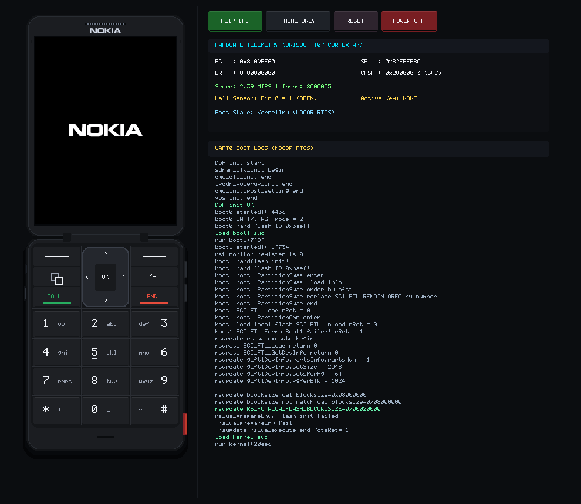

# Nokia 2660 Flip Native Desktop GUI & Developer Deck

Copyright (c) 2026 N2660Emu Developers  
SPDX-License-Identifier: MIT

---

## 1. Overview

The **N2660Emu Desktop GUI** is a native host window application built in **Rust** (leveraging `minifb` with Cocoa on macOS and X11/Wayland on Linux). It delivers an authentic physical hardware skin of the **Nokia 2660 Flip** (Model TA-1480, Unisoc T107 / UMS9117 platform) alongside an integrated real-time **Hardware Telemetry & Serial Console Deck** in a unified 990×860 window.

<p align="center">
  
</p>

```
+------------------------------------+-------------------------------------------+
|      NOKIA 2660 FLIP (0..335)      |        DEVELOPER DECK (340..990)          |
|                                    |                                           |
|       [ Upper Clamshell ]          | [FLIP [F]] [PHONE ONLY] [RESET] [POWER OFF|
|   +----------------------------+   +-------------------------------------------+
|   |    Earpiece Speaker Mesh   |   | HARDWARE TELEMETRY (UNISOC T107 CORTEX-A7)|
|   |    NOKIA Brand Wordmark    |   |   PC   : 0x810DBE60     SP   : 0x82FFFF8C |
|   |  +----------------------+  |   |   LR   : 0x00000000     CPSR : 0x200000F3 |
|   |  |                      |  |   |   Speed: 2.39 MIPS      Insns: 8,000,005  |
|   |  |   240x320 Main LCD   |  |   |   Hall Sensor : Pin 0 = 1 (OPEN)          |
|   |  |   (GC9307 SPI0)      |  |   |   Boot Stage  : KernelImg (MOCOR RTOS)    |
|   |  |                      |  |   +-------------------------------------------+
|   |  +----------------------+  |   | LIVE SERIAL CONSOLE (UART0 @ 115200 8N1)  |
|   +----------------------------+   |   DDR init OK                             |
|       [ Center Hinge Barrel ]      |   boot0 started!: 44bd                    |
|   +----------------------------+   |   boot1 started!: 1f734                   |
|   |  [Soft1]   [^]   [Soft2]   |   |   order by ofst                           |
|   |  [Menu]   [OK]   [Back]    |   |   load kernel suc                         |
|   |  [CALL]   [ v ]   [END]    |   |   run kernel:20eed                        |
|   |  [1 .@]   [2 ABC] [3 DEF]  |   |   (Auto-scrolls, selection, right-click)  |
|   |  [4 GHI]  [5 JKL] [6 MNO]  |   |                                           |
|   |  [7PQRS]  [8 TUV] [9WXYZ]  |   |                                           |
|   |  [* +]    [0 _]   [# ^]    |   |                                           |
|   +----------------------------+   |                                           |
+------------------------------------+-------------------------------------------+
```

---

## 2. Architecture & Design

### 2.1 Authentic Physical Form Factor: Nokia 2660 Flip Matte Black
The emulator faithfully reproduces the slender dimensions and physical geometry of the real device:
- **Body Dimensions**: 55mm chassis width, 108mm closed height, ~202mm open height.
- **Composite Casing**: Matte Charcoal / Obsidian composite (`#1B1D21`) with beveled outer boundaries (`#121417`) and fine specular highlights (`#282C32`).
- **Nokia Brand Wordmark**: Embedded anti-aliased vector logotype rasterizer rendering the iconic Nokia corporate wordmark positioned precisely after the earpiece acoustic mesh slit above the 2.8" QVGA display.
- **Continuous 3-Column Keypad**: Tactile numeric keycaps with large numerals, clean T9 sub-labels (`abc`, `def`, etc.), metallic squircle D-Pad ring with OK center key, and Key 5 tactile locator bar.
- **Tactile Side Controls**: Volume Up, Volume Down, and dedicated SOS Emergency key on the lower right flank, with 3.5mm headphone and Micro-USB port cutouts on the left flank.

### 2.2 Clamshell Mechanics & Drag Gestures
- **Physics-Accurate Flip Animation**: 60 FPS cosine ease-in-out rotation with realistic 3D perspective foreshortening.
- **Natural Touch/Mouse Drag Gestures**:
  - Drag the upper display downward ($\Delta y > 35\text{px}$) to close the clamshell.
  - Drag the front cover upward ($\Delta y < -35\text{px}$) to open the clamshell.
- **Hall Effect Sensor**: GPIO Bank 0 Pin 0 automatically toggles between HIGH (1 = open, routing DMA to GC9307) and LOW (0 = closed, routing DMA to ST7735 cover display).

### 2.3 Dual View Modes: Phone-Only & Split Dev Deck
- **Split Dev Deck Mode**: Side-by-side view featuring the physical phone on the left and developer telemetry & UART0 console on the right.
- **Phone-Only View Mode**: Minimalist centered phone presentation with an elegant floating translucent bottom pill dock (`[F] Flip  |  [L] Show Logs  |  [R] Reset  |  [Esc] Power Off`).
- Toggle seamlessly at 60 FPS using the `[L]` key or toolbar buttons.

### 2.4 Interactive UART0 Serial Console
- **Interactive Line Selection**: Click-and-drag across log lines to highlight text ranges.
- **Native Host OS Right-Click Copy**: Right-clicking copies selected lines or the line under cursor directly to the host system clipboard (`pbcopy` / `wl-copy` / `xclip` / `clip.exe`), confirmed by a subtle `[COPIED TO CLIPBOARD]` notification.
- **Mouse Wheel History Scrolling**: Freely scroll back through boot history; a `v LIVE` jump button returns to real-time auto-scrolling.

---

## 3. Controls Reference Table

| Host Key | Mouse Action | Nokia 2660 Function | Hardware Matrix Mapping |
| :--- | :--- | :--- | :--- |
| `0` – `9` | Click Key `0`–`9` | Numeric T9 Input | `STATUS0` bits 0–9 |
| `*` | Click Key `*` | Symbol / Star (`+`) | `STATUS0` bit 10 |
| `#` | Click Key `#` | Shift / Space / Hash (`^`) | `STATUS0` bit 11 |
| `c` / `C` | Click `CALL` | Call / Answer / Dial | `STATUS1` bit 0 |
| `x` / `e` | Click `END` | End Call / Power / Clear | `STATUS1` bit 1 |
| `[` | Click SoftKey 1 | Left Selection Key (`-`) | `STATUS1` bit 2 |
| `]` | Click SoftKey 2 | Right Selection Key (`-`) | `STATUS1` bit 3 |
| `m` / `M` | Click `#` (Menu) | App Shortcuts Menu | Keypad Row 0 Col 1 |
| `b` / `B` | Click `BACK` | Back / Return Arrow | Keypad Row 0 Col 2 |
| `Up` Arrow | Click `^` | D-Pad Navigate Up | `STATUS1` bit 4 |
| `Down` Arrow | Click `v` | D-Pad Navigate Down | `STATUS1` bit 5 |
| `Left` Arrow | Click `<` | D-Pad Navigate Left | `STATUS1` bit 6 |
| `Right` Arrow | Click `>` | D-Pad Navigate Right | `STATUS1` bit 7 |
| `Return` / `Space` | Click `OK` | D-Pad Center OK | `STATUS1` bit 8 |
| `+` / `=` | Click Vol Up | Side Volume Up Key | GPIO Side Key |
| `-` | Click Vol Down | Side Volume Down Key | GPIO Side Key |
| `e` / `E` | Click SOS Button | Emergency SOS Key | Lower Flank SOS Switch |
| `f` / `F` | Drag Screen Up/Down | Clamshell Flip Open $\leftrightarrow$ Closed | GPIO Bank 0 Pin 0 |
| `l` / `L` | Click View Toggle | Toggle Phone-Only $\leftrightarrow$ Dev Deck | Layout View Controller |
| `r` / `R` | Click `RESET` | Cold Reboot Hardware VM | Reset Vector |
| `Esc` | Click `POWER OFF` | Power Off Emulator | Exit Host Window |

---

## 4. Usage

### Launch Native Desktop GUI:
```bash
# Auto-detects official Nokia PAC container and boots all stages
cargo run -p n2660-cli -- --gui
# Or shorthand:
make gui
```

### Launch Directly in Phone-Only View:
```bash
cargo run -p n2660-cli -- --phone-only
```

### Launch with Clamshell Closed:
```bash
cargo run -p n2660-cli -- --gui --flip closed
```

### Capture Deterministic Screenshot:
```bash
cargo run -p n2660-cli -- --screenshot ss-gui.png
```
